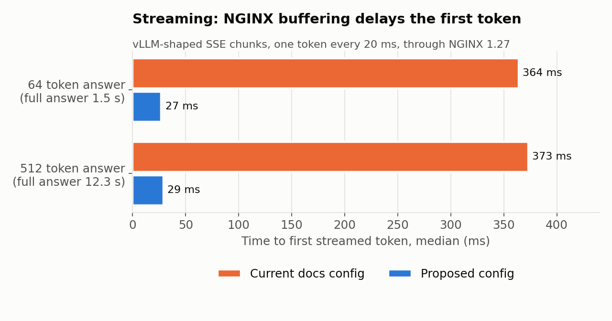
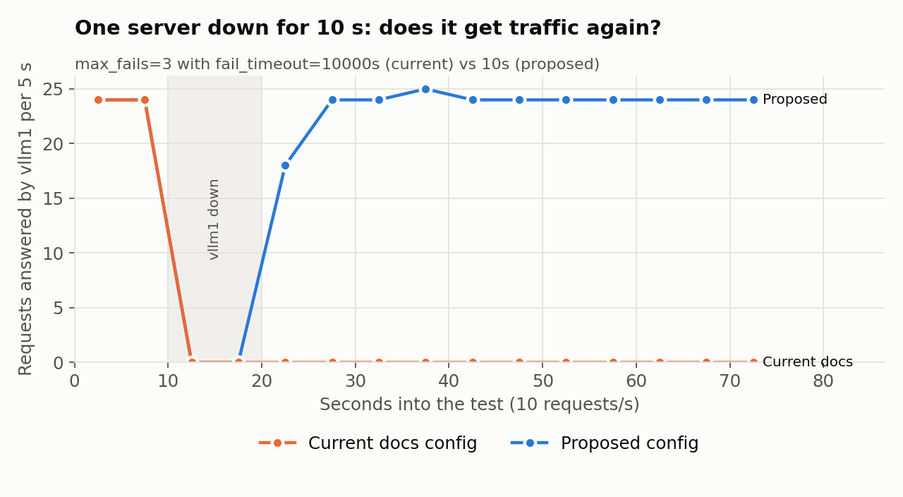
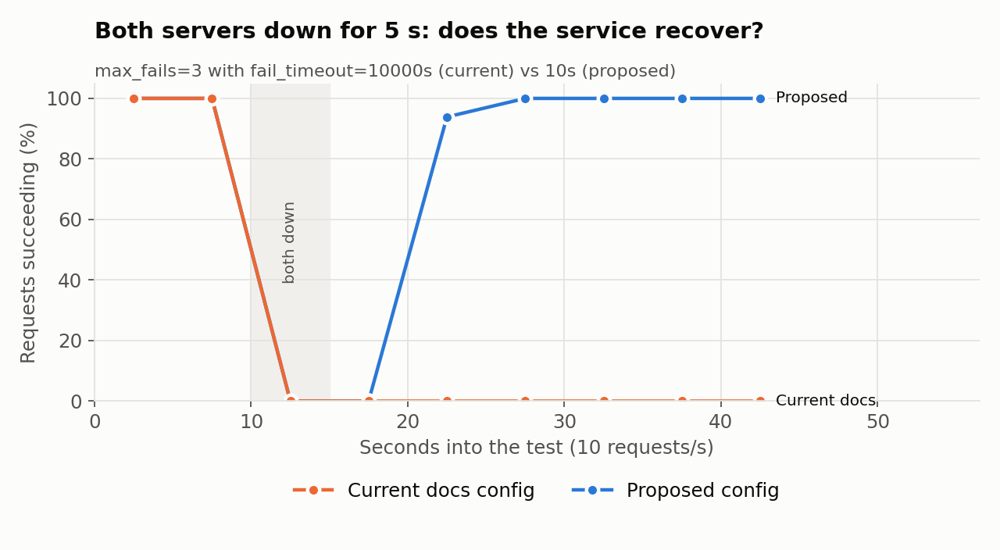

# vLLM's NGINX guide: three config problems, reproduced

In Phase 6 my NGINX load balancer caused an outage while both vLLM servers were healthy: 1,574 errors at 768 users. When I compared my fixed config with vLLM's own guide for running NGINX in front of vLLM ([`docs/deployment/nginx.md`](https://github.com/vllm-project/vllm/blob/main/docs/deployment/nginx.md)), I found that the guide's config has the same problems and one more. This folder reproduces all three on a laptop, with Docker and no GPU, and is the evidence for a docs fix to vLLM.

## The three problems

1. **`fail_timeout=10000s`.** NGINX uses `fail_timeout` for two things: the window in which `max_fails` errors mark a server as failed, and how long that server then stays out of rotation. After 3 errors, a vLLM server gets no traffic for 10,000 seconds (2 h 47 min), even once it's healthy. If every server is marked failed, every request gets a `502` for that long.
2. **Streaming is buffered.** NGINX buffers responses by default, and vLLM doesn't send the `X-Accel-Buffering: no` header that would turn it off. Streamed tokens reach the client in batches of about 4 KB (about 15 tokens) instead of one at a time, so the first token is late and the stream is choppy.
3. **No keepalive guidance.** vLLM closes idle connections after 5 seconds (`VLLM_HTTP_TIMEOUT_KEEP_ALIVE`). If NGINX keeps idle connections longer, it sometimes sends a request on a connection vLLM is closing, and the request fails with `502` (`Connection reset by peer`). Each failure also counts towards `max_fails`, which leads into problem 1. That's what happened in my Phase 6 run.

## Results

Run on 2026-10-17 with NGINX 1.27.5. Every number comes from the raw output in [`results/`](results/).

| Test | Guide's config | Proposed config |
|---|---|---|
| First streamed token, 64 token answer (median of 20) | 364 ms | 27 ms |
| First streamed token, 512 token answer (median of 10) | 373 ms | 29 ms |
| One server down for 10 s, then back: its traffic for the rest of the test | none | back to its half right away |
| Both servers down for 5 s, then back: requests failing afterwards | all of them, to the end of the test | none, once `fail_timeout` expired about 5 s later |
| Keepalive race, 1,664 requests against a busy server | 3 failed with `502` | 0 failed |







## What's being tested

- **`server.py`** stands in for vLLM's OpenAI server: FastAPI and uvicorn with vLLM's 5 second idle keepalive, streaming chunks shaped like vLLM's (about 270 bytes each) at one token every 20 ms.
- **`nginx/docs.conf`** is the guide's config, copied exactly. **`nginx/docs_keepalive.conf`** adds upstream keepalive the way NGINX's own docs say to. **`nginx/proposed.conf`** is the fix, and it's the exact config in the vLLM docs change.
- **`client.py`** measures time to the first token, which server answers each request, and how many requests fail.

## Honest limits

- The servers are stand-ins, not real vLLM. They match the parts that matter here (uvicorn's keepalive, the SSE format, chunk sizes), but nothing runs on a GPU.
- The keepalive race only shows up when the server's event loop is busy, so `BUSY_MS=50` blocks the stand-in's loop in 50 ms slices to model an API server streaming many responses. Even then it's rare locally: 3 in 1,664 requests, the same count in two separate runs. The real world evidence is my Phase 6 run on two RTX 5090s, where the same mismatch caused 1,574 errors and the fix brought it to 0 up to 1,024 users.
- The streaming delay depends on chunk size and token speed. At a faster decode rate the delay shrinks, but tokens still arrive in batches.

## Run it

```bash
./run_all.sh                    # every test, raw output to results/ (about 17 minutes)
docker build -t nginx-repro-plot - <<'EOF'
FROM python:3.12-slim
RUN pip install --no-cache-dir matplotlib==3.9.2
EOF
docker run --rm -v "$PWD:/w" -w /w nginx-repro-plot python plot.py results charts
```

Or one test at a time:

```bash
./lab.sh up docs                # or: proposed, docs_keepalive
./lab.sh client ttfb 20 64
./lab.sh client spread 75 10    # take vllm1 down: docker exec vllm1 sh -c 'touch /tmp/down; pkill -f server.py'
BUSY_MS=50 ./lab.sh up docs_keepalive && ./lab.sh client bursts 270 32
./lab.sh down
```
